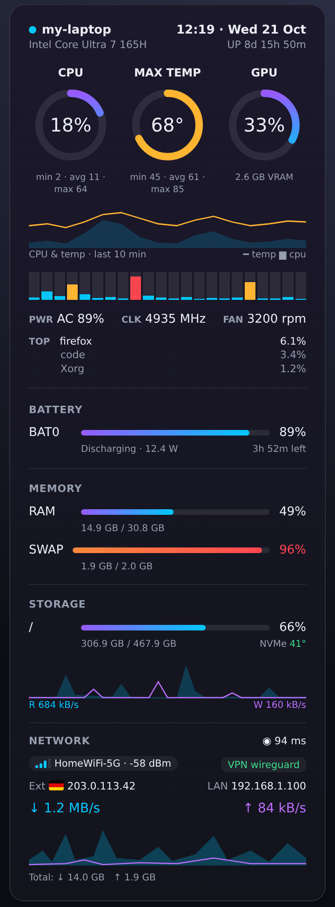
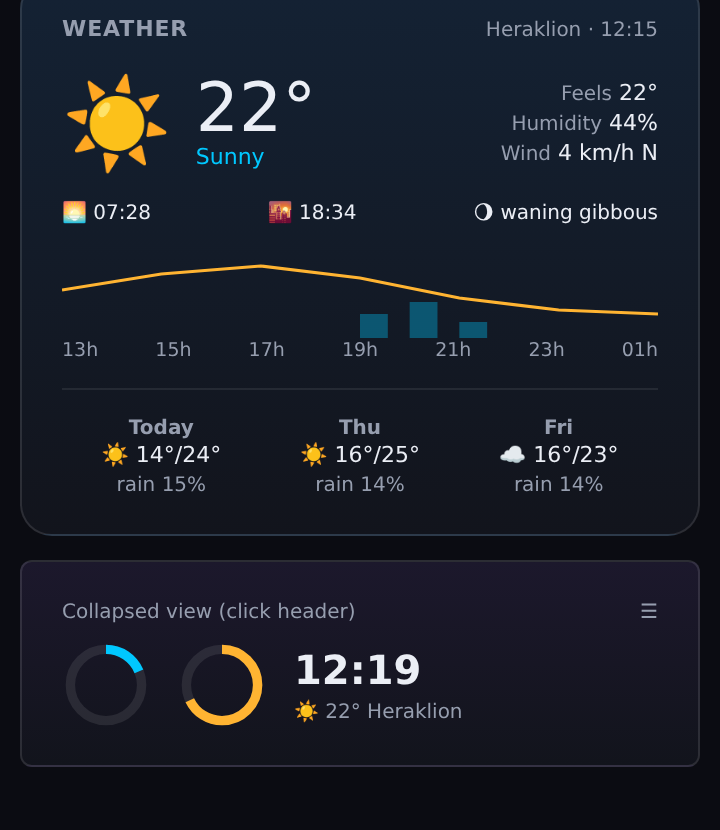

# Coreglow

Glowing system monitor **desklet for Linux Cinnamon**. A port of the [Coreglow Rainmeter skin](https://github.com/stavros-it/coreglow-rainmeter) to the Cinnamon desktop: CPU, temperature, GPU, RAM, storage, network and weather in one dark (or light) glass card.

<p align="center">
  
  &nbsp;&nbsp;
  
</p>

<sub>Preview rendered with sample data.</sub>

## Features

- **CPU / max temperature / GPU rings** with min / avg / max of the last hour
- CPU + temperature history graph (10 min) and per-thread load bars
- Power source, CPU clock, fan speed (ThinkPad and other `hwmon` fans), top 3 processes
- **Battery**: percentage, power draw (W), time remaining
- **Memory**: RAM and swap bars that turn orange/red as they fill
- **Storage**: usage, NVMe temperature, live read/write graph
- **Network**: download/upload graph, Wi-Fi SSID + signal, VPN indicator, ping, external IP with country flag, LAN IP
- **Weather** via [wttr.in](https://wttr.in): current conditions, sunrise/sunset, moon phase, hourly temperature + rain, 3-day forecast. Click it to open the full forecast
- Collapsible small card (click the header)
- Follows the Cinnamon light/dark theme, or force one; custom accent colours; adjustable scale and background opacity
- Visual alert when CPU load stays above a threshold for 30 s

## Requirements

- Linux with **Cinnamon** (developed and tested on 6.0)
- `curl`, `ping`, `nmcli` (NetworkManager), `top`, `ip` — present on most distros
- Optional: NVIDIA GPU + `nvidia-smi` for GPU usage, VRAM and temperature (the GPU ring is NVIDIA-only; a sleeping hybrid-graphics dGPU is shown as asleep and never woken up)
- Internet access for weather, external IP and flag (see [Privacy](#privacy))

## Installation

```bash
git clone https://github.com/genetzhs/coreGlow-applet.git
cd coreGlow-applet
cp -r coreglow@genetzhs ~/.local/share/cinnamon/desklets/
```

Then:

1. Right-click the desktop → **Add Desklets** (or open *System Settings → Desklets*).
2. Select **Coreglow** and click **+** to add it to the desktop.
3. If it does not show up, reload Cinnamon: `Ctrl+Alt+Esc`, or run `cinnamon --replace &`.

To update, pull the repo and copy the folder again. To hack on it, symlink instead of copying:

```bash
ln -s "$PWD/coreglow@genetzhs" ~/.local/share/cinnamon/desklets/coreglow@genetzhs
```

## Configuration

Right-click the desklet → **Configure**.

| Setting | Default | Description |
|---|---|---|
| Scale | 1.25 | Size multiplier (1 = 300 px wide) |
| Background opacity | 0.80 | Card transparency |
| Theme | Follow Cinnamon | Follow Cinnamon, Dark or Light |
| Accent colour 1 / 2 | cyan / violet | Download + read, upload + write |
| Location | Heraklion, Crete, Greece | Weather location. Empty = auto by IP |
| Refresh interval | 30 min | Weather refresh (5–180 min) |
| Ping host | 1.1.1.1 | Host used for the latency reading |
| CPU alert threshold | 90 % | Alert when CPU stays above this for 30 s |
| Collapsed | off | Show the small card (or click the header) |

Up to 3 instances can run at once.

## Privacy

Everything is read locally from `/proc` and `/sys`. The desklet contacts these services, with no API keys or accounts:

| Service | Used for |
|---|---|
| `wttr.in` | Weather (sends your configured location, or your IP if empty) |
| `ipinfo.io` | External IP and country |
| `flagcdn.com` | Country flag image (cached in `~/.cache/coreglow`) |

## Troubleshooting

- **No GPU reading**: GPU stats need an NVIDIA card with the proprietary driver (`nvidia-smi`).
- **No fan / battery / NVMe row**: your hardware does not expose it under `/sys`.
- **Weather empty**: check the location spelling and your connection (`curl wttr.in/YourCity?format=3`).
- Errors are logged in Cinnamon's *Looking Glass* (`Alt+F2` → `lg`).

## Credits

Design and layout based on [coreglow-rainmeter](https://github.com/stavros-it/coreglow-rainmeter) by stavros-it. This is an independent Cinnamon port.
